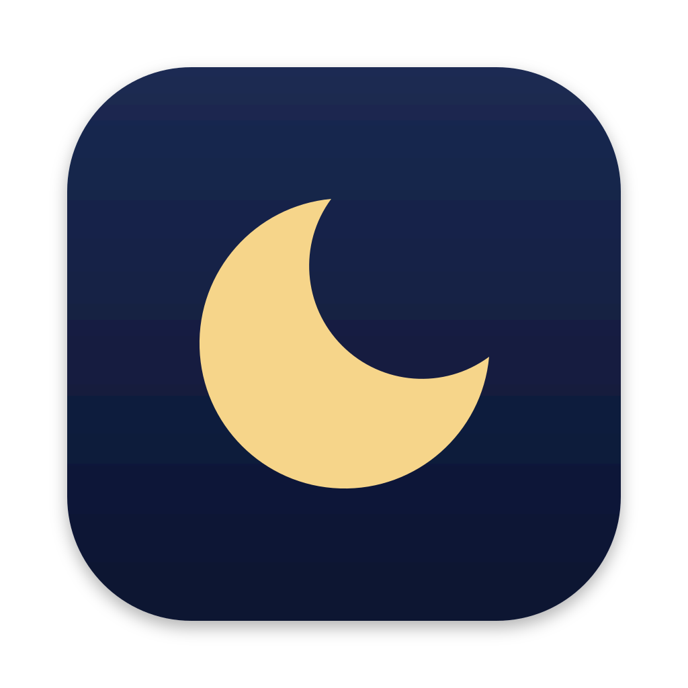

<p align="center"></p>

# Nightcap

Night Shift, made yours. Nightcap brings Night Shift to your menu bar. Set how warm it gets, switch it or peek past it with a shortcut, and keep it off while the apps and websites you choose are in front. The rest of the time, your schedule runs as usual.

[Download for Mac](https://nightcap.choco.me/) · macOS 15 or later, Apple silicon · Free and open source

## What it does

- **App rules.** Pick the apps that need true colour, such as Figma or Photoshop. While one is in front, Night Shift stays off. A rule can keep it on instead, say in Books, even by day.
- **Website rules.** The same for sites in Safari, Chrome, Firefox, Edge, Arc, Brave, Dia, Zen and Orion, such as `figma.com` and its subdomains. Website checking stays off until you turn it on, and needs Accessibility: Nightcap reads the front tab's address and keeps only the site's name.
- **Your schedule stays yours.** A rule applies only while its app or site is in front. Switch away and the schedule decides again.
- **Where and for how long.** Turn Night Shift on or off everywhere, or just in the app or site in front: for 30 minutes, an hour or two, until a time you pick, or until the schedule next turns it back. Snoozing a rule is turning its app or site the other way for a while.
- **It goes along with you.** Turn Night Shift on in Control Center while a rule holds it off, and Nightcap snoozes that rule until the schedule next turns it back, instead of fighting you.
- **One shortcut, two moves.** Tap ⌃⌥⌘N in any app to turn Night Shift on or off everywhere, until you turn it back. Hold it to see true colour for as long as you hold, with Night Shift still on. Record another shortcut in Settings.
- **How warm.** A slider in the menu sets Night Shift's strength, and `nightcap strength` does the same from a script.
- **Made to be scripted.** Everything in the menu is also a `nightcap` command, and rules can live in a config file next to the rest of your setup.

## Install

Download the DMG from [the site](https://nightcap.choco.me/), or the zip from [Releases](https://github.com/choco/Nightcap/releases), and drag Nightcap to Applications. Releases are signed and notarized. The first time it opens, Nightcap sets up Night Shift's strength and schedule with you, suggests apps and websites to keep it off for, and asks about notifications and opening at login; you can change each later in Settings.

A copy in Applications checks for updates once a day and installs them when it quits.

The command line tool is inside the app. Link it into a folder on your `PATH`, such as `~/.local/bin`:

```sh
ln -s /Applications/Nightcap.app/Contents/Helpers/nightcap ~/.local/bin/nightcap
```

Packaging Nightcap for Nix, Homebrew or a script? [`docs/installing.md`](docs/installing.md) is the contract: what a release contains, how to install it so permissions survive updates, and how to start it.

## The command line

```sh
nightcap status                          # what Nightcap is doing, and why
nightcap off                             # off everywhere, until you turn it on
nightcap off --for 1h30m                 # off everywhere for a while
nightcap on --app com.figma.Desktop --until-schedule   # snooze Figma's rule until sunrise
nightcap reset                           # back to the schedule
nightcap rules add app:com.figma.Desktop
nightcap rules add domain:figma.com
nightcap rules add app:com.apple.iBooksX --on          # keep Night Shift on in Books
nightcap strength 40                     # how warm Night Shift gets, 0 to 100
nightcap status --json | jq -r .front.decision.state
```

`nightcap --help` lists the rest. `--json` prints a schema of the CLI's own, which [`docs/installing.md`](docs/installing.md#scripting-against-the-cli) describes, for scripts to rely on.

## The config

Rules can also live in `~/.config/nightcap/config.toml`:

```toml
websites = true
lengths = ["30m", "1h", "2h"]    # what a change can be picked for

[rules.off]
app = ["com.figma.Desktop", "com.adobe.Photoshop"]
domain = ["figma.com"]

[rules.on]
app = ["com.apple.iBooksX"]

[night_shift]
strength = 60
schedule = "sunset-to-sunrise"   # or "off", or custom hours such as "22:00-07:00"
```

Run `nightcap reload` after changing it. Night Shift's strength and schedule stay the system's: Nightcap applies a `[night_shift]` value when it changes, so a change you make later in System Settings stands. Rules you add from the menu or with `nightcap rules add` are kept by Nightcap itself, and `nightcap rules export --format toml` (or `nix`) prints them ready to paste into the config. [`docs/installing.md`](docs/installing.md) has the details.

## Privacy

- A copy that updates itself checks for a new release once a day. A copy whose updates a package manager handles, such as one in the Nix store, never does.
- With website checking on, Nightcap reads only the front tab of the browser in front, and keeps only the site's name. macOS's log shows it as `<private>`.
- With website checking on, opening the menu asks the site in front, and the sites your rules name, for their icons, with no cookies. The icons stay in Nightcap's cache, named by site, until macOS or you clear it.
- Onboarding's websites step asks the sites it suggests, the same for everyone, for their icons.

The [privacy policy](https://nightcap.choco.me/privacy/) has the details, and the [terms](https://nightcap.choco.me/terms/) cover using Nightcap and its site.

## How it works

Night Shift has no public API, so Nightcap drives it through macOS's private CoreBrightness framework. It checks the framework's method signatures when it starts: if a macOS update changes them, Nightcap shows Night Shift as unavailable rather than guessing. It has been checked on macOS 15 and 27.

The app is a Swift shell that owns every Apple API, around a Rust core that makes every decision. The decisions behind it, and the alternatives they beat, are in [`docs/adr/`](docs/adr/).

## Building

Work inside `nix develop`, which provides the pinned Rust toolchain and puts the build scripts on `PATH`:

```sh
build-core        # the Rust core and CLI, and the app's generated bindings
build-app         # build/xcode/Debug/Nightcap Dev.app, unsigned
run-dev           # builds, signs and launches the dev build
run-tests         # the Rust tests
test-app          # the Swift tests
check             # everything CI checks
```

The dev build has its own bundle ID, so it runs beside an installed copy without sharing its permissions or state. [`AGENTS.md`](AGENTS.md) covers the rest of the workflow.

## Contributing

Issues and pull requests are welcome. Read the [AI policy](AI_POLICY.md) first: it says how AI tools can be used here, and what every contribution needs.

## Support

Nightcap is free. If it's useful to you, you can [sponsor its work on GitHub](https://github.com/sponsors/choco).

## Licence

[MIT](LICENSE). The site's fonts are under the SIL Open Font License, with their licences in [`design/licenses/`](design/licenses/).
